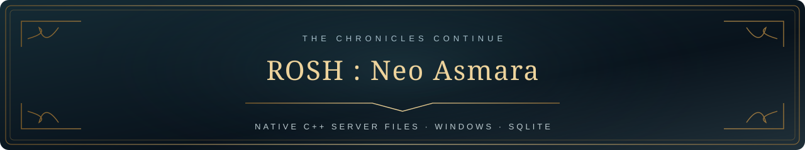
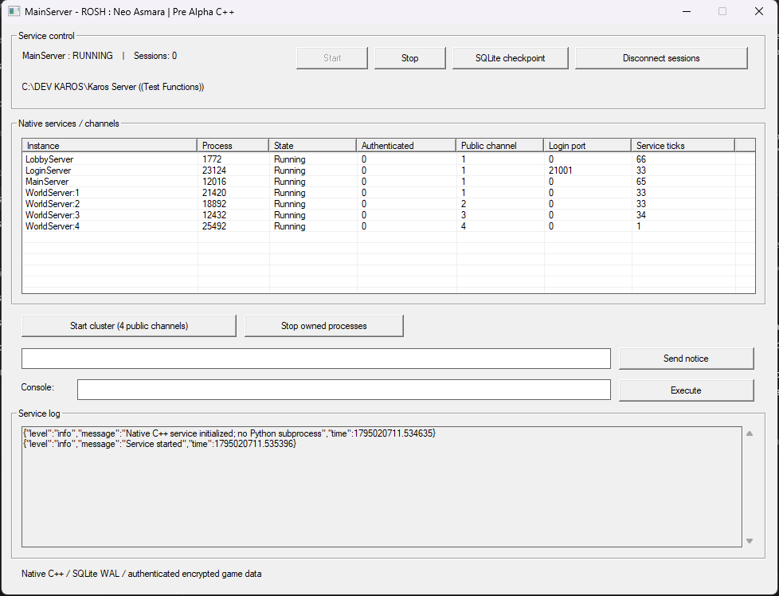
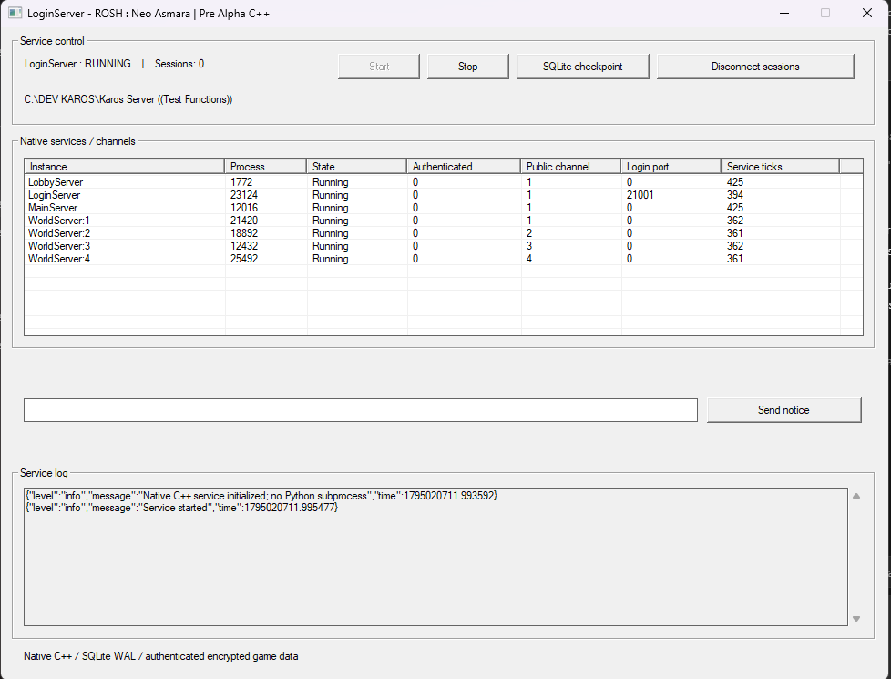
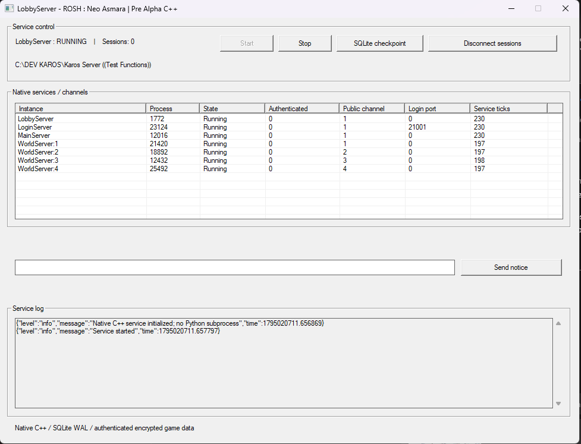
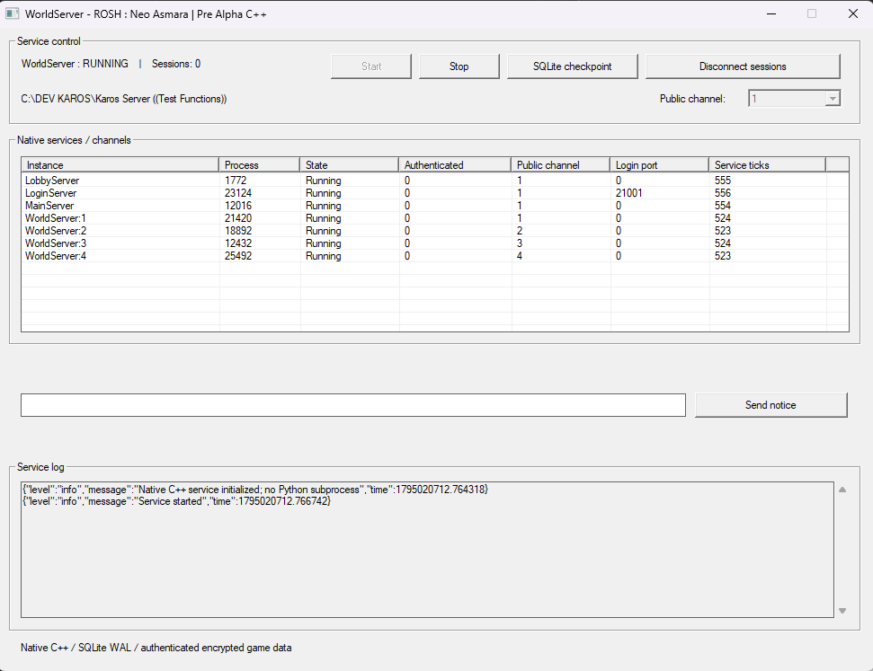

<p align="center"></p>

# NeoAsmara Core — Source Code

C++ source, build scripts and reviewed server-side data for the NeoAsmara Core. This repository is for developers who want to inspect, modify or compile the server services.

<p align="center"><a href="#build-on-windows">Build</a> · <a href="#apply-a-core-update">Apply an update</a> · <a href="#prepare-server-files">Prepare server files</a> · <a href="docs/IN_GAME_COMMANDS.md">Staff commands</a> · <a href="#requirements">Requirements</a></p>

## Build output

The source builds the native Windows server programs and supporting services. These screenshots are from the compiled server tools included in a matching NeoAsmara Core installation.

<table>
<tr><td width="50%"><strong>MainServer</strong><br></td><td width="50%"><strong>LoginServer</strong><br></td></tr>
<tr><td><strong>LobbyServer</strong><br></td><td><strong>WorldServer</strong><br></td></tr>
</table>

The panels show a local development installation. Process IDs, paths and service counts are specific to that machine; screenshots do not imply that every game feature is complete.

## What is included

- C++ source for the Core's native services and server programs.
- Windows build scripts, a pinned compiler bootstrapper and build-time checks.
- Reviewed dungeon data overrides and dungeon review notes.
- Tests and tools for the source workflows described below.

This source package does **not** include game-client assets, authenticated/encrypted game catalogs, private release keys, player databases, backups or the complete preconfigured server-files distribution. To run the server, use a matching NeoAsmara server-files package alongside this source.

## Requirements

| Requirement | Use |
|---|---|
| Windows x64 | Build and run the native Core. Windows 11 IoT is the locally tested system. |
| Python 3.11+ (64-bit) | Downloads the pinned compiler when needed and runs resource-analysis tools. |
| Windows PowerShell 5.1+ | Runs `BUILD.ps1`; included with Windows. |
| LLVM-MinGW, UCRT x86_64 | C++ compiler and linker. `BUILD.cmd` downloads and verifies the pinned release if it is not already present. |
| Visual Studio Code, Git for Windows | Optional editor and version-control tools. |
| DB Browser for SQLite | Optional; inspect only a disposable database copy, with the related server stopped. |

No SQL Server, standalone SQLite server, .NET or Python runtime is required to run the compiled C++ services. The Core uses Windows' built-in SQLite runtime. CMake and Visual Studio Build Tools are optional alternatives; the portable LLVM-MinGW path is the one configured for this source export.

## Build on Windows

1. Extract this source folder to a writable location. Its folder name and path can be changed.
2. Install Python 3.11 or newer and confirm `python --version` works in PowerShell.
3. Double-click `BUILD.cmd` and let it download and verify the pinned LLVM-MinGW compiler on the first build.
4. Find the output in `build/native`.

The build produces the server executables, `KarosRuntime.dll`, data/account/GM services, `ServerControl.exe`, required runtime DLLs and test binaries. Building does not install files into a server folder or restart a running service.

If you already installed LLVM-MinGW elsewhere, open PowerShell in the source folder and provide its installation root. It must contain `bin/x86_64-w64-mingw32-clang++.exe`:

```powershell
$toolchainRoot = Read-Host 'Path to the LLVM-MinGW installation folder'
.\BUILD.ps1 -ToolchainRoot $toolchainRoot
```

The compiler archive's SHA-256 is pinned in `tools/native_toolchain.json` and checked before extraction. You do not need to edit the build script to point it at a developer-specific path.

## Dependencies

| Dependency | How it is provided |
|---|---|
| LLVM-MinGW / UCRT | Pinned release and SHA-256 in `tools/native_toolchain.json`; downloaded by the bootstrap helper when needed. |
| nlohmann/json 3.12.0 | Included in `third_party/nlohmann` under its MIT license. |
| SQLite C API header | Included as `include/sqlite3.h`. |
| SQLite runtime | Windows `winsqlite3.dll`; the build creates the import library. |
| Win32, Winsock, BCrypt, DPAPI and common controls | Windows and compiler SDK headers/libraries. |
| Python 3.11+ | Compiler setup and optional resource-analysis tools. |

For the alternative CMake workflow, use CMake 3.20+ and a Windows SDK. The native CMake configuration needs `winsqlite3.lib`; `ROSH_NATIVE_WINDOWS=OFF` builds the older offline lab and requires a separate SQLite development package.

## Apply a Core update

`BUILD.cmd` only compiles. To apply the compiled binaries to a server installation:

1. Use the **matching NeoAsmara server-files release**. Do not mix files from different releases.
2. Stop that installation with its own `STOP.cmd` and wait for the services to exit.
3. Keep its `Config`, `Data`, `Database`, `Bootstrap` and `Updates` folders together.
4. Open PowerShell in this source folder and run the following. When prompted, enter the full path to the matching server-files folder:

```powershell
$serverRoot = Read-Host 'Full path to the matching server-files folder'
$sourceBin = Join-Path (Get-Location) 'build\native'
$targetBin = Join-Path $serverRoot 'Bin'
$files = @(
    'KarosRuntime.dll', 'LoginServer.exe', 'MainServer.exe',
    'LobbyServer.exe', 'WorldServer.exe', 'KarosDataTool.exe',
    'RoshGmService.exe', 'RoshAccountService.exe', 'ServerControl.exe',
    'libc++.dll', 'libunwind.dll'
)

if (-not (Test-Path -LiteralPath $targetBin -PathType Container)) {
    throw 'The selected folder is not a server-files installation with a Bin directory.'
}
foreach ($file in $files) {
    if (-not (Test-Path -LiteralPath (Join-Path $sourceBin $file) -PathType Leaf)) {
        throw "Build output is missing: $file. Run BUILD.cmd first."
    }
}
foreach ($file in $files) {
    Copy-Item -LiteralPath (Join-Path $sourceBin $file) -Destination $targetBin -Force
}
```

5. Start the installation with its normal `START.cmd`. If a service fails, check its `Logs` folder.

This replaces only the listed Core binaries and runtime libraries. It does not change player databases, configuration, encrypted catalogs, client files, launcher hashes or signatures. Keep a copy of the existing `Bin` files if you need to roll back.

## Prepare server files

The source repository is **not** a complete server-files generator. It does not contain the encrypted `Data` catalogs, private release content key, clean database seeds or release-specific `Initialize.exe`; `BUILD.cmd` cannot recreate those files.

To prepare a server-files package, start with an untouched server-files release that matches this source revision, extract it to a new folder, then apply the update steps above. Do not use a live server folder as the package template because its databases may contain player accounts and progress. Keep the release's `Bootstrap\Database` seeds and `Initialize.exe`. Never distribute a generated `Config\Keys\content.key.dpapi` from an initialized machine.

To ZIP a clean package before its first start:

```powershell
$packageRoot = (Resolve-Path (Read-Host 'Path to the prepared server-files folder')).Path
if (Test-Path -LiteralPath (Join-Path $packageRoot 'Config\Keys\content.key.dpapi')) {
    throw 'This folder has already been initialized. Do not publish its machine-protected content key.'
}
$zip = Join-Path (Split-Path $packageRoot -Parent) ((Split-Path $packageRoot -Leaf) + '.zip')
if (Test-Path -LiteralPath $zip) { throw "Archive already exists: $zip" }
Compress-Archive -Path (Join-Path $packageRoot '*') -DestinationPath $zip -CompressionLevel Optimal
```

The recipient extracts the package and runs `START.cmd`. First-run initialization creates the local protected key and preserves existing databases on later starts.

Changes under `ReferenceOverrides` or other authenticated server data need a separate staging and signing step using the matching release content key. Copying compiled binaries alone does not install those data changes. Client or launcher patches also require their own protected-file hashes and signed update publication.

## Tests and dungeon notes

`BUILD.ps1` runs the foundation tests and builds dungeon domain and packet-flow tests. Dungeon tests need authenticated content and an isolated fixture marked `GM_TEST_FIXTURE`; never point them at live player databases. Other tests under `tests` have their own fixture requirements.

The distribution helpers are under `tools/distribution`. `initialize.cpp` requires an owner-generated `release_content_key.hpp`, so the private release key is not included and the normal build does not compile that release-only initializer.

See [Dungeon review](docs/DUNGEON_REVIEW.md) and [Dungeon coverage](docs/DUNGEON_COVERAGE.md) for the Peltok entrance correction, review notes and remaining limitations. This source release does not claim complete dungeon parity or production readiness.

## Staff commands

See [In-game staff commands](docs/IN_GAME_COMMANDS.md) for syntax, access levels, staff authentication, aliases and known limitations. The guide describes this source revision; check the installed server build before relying on commands in a compiled release.

---

[](https://ko-fi.com/neoasmara)

Donations are optional and help support continued development.

## License

Copyright © 2026 LuspX_

This source distribution is released under the **NeoAsmara Project License v1.1 (NAPL)**. You may use, modify, redistribute and commercially operate NeoAsmara under its terms.

- Public or commercial servers must display **`: NeoAsmara`** in their official title, launcher and primary public listings.
- Distributed source-code modifications must remain publicly available under **NAPL v1.1**.
- Preserve copyright notices, attribution headers and permanent credits in [CONTRIBUTORS.md](CONTRIBUTORS.md).
- Operators are responsible for third-party trademarks, clients and game assets.

See [LICENSE.md](LICENSE.md) for the complete terms. Third-party dependencies retain their own licenses.

**NeoAsmara is an independent, unofficial project.**
